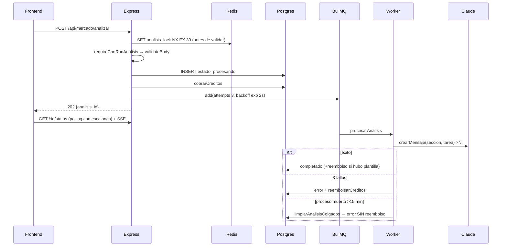
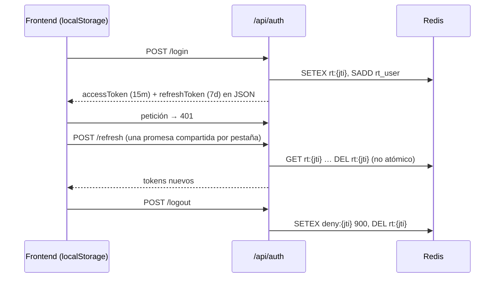

# Auditoría Enterprise Pre-Deploy (modo paranoico) — BI 0 A 100

**Fecha:** 2026-09-14 · **Rama:** `master` (HEAD `919115e`) con 23 archivos modificados y 6 rutas sin trackear
**Método:** análisis estático del repositorio completo + ejecución real de typecheck, lint, tests, build, `npm audit`, consultas de solo lectura a la base de desarrollo y pruebas HTTP/navegador contra el entorno Docker local (`bi0a100-*`, healthy).
**Regla aplicada:** lo que no se pudo ejecutar se marca **No verificado**. Nada se da por bueno por lo que diga un documento.

> **Actualización 2026-09-14 — P0 corregidos (sin commit):**
> - **#1** `next` 16.2.9 → **16.3.5** + `npm audit fix` → `npm audit --omit=dev`: **0 vulnerabilidades** en frontend. Typecheck, lint (0 errores) y `next build` en verde.
> - **#2 y #3** Nuevo `backend/src/config/entorno.ts` (`verificarEntornoProduccion`, llamado en `initializeApp`): en producción el backend no arranca sin almacenamiento, claves de admin, secretos JWT, `STRIPE_WEBHOOK_SECRET`, `STRIPE_PRODUCT_*` de cada plan con precio ni `NEXT_PUBLIC_APP_URL` si hay correo; detecta `S3_BUCKET_NAME` mal nombrada. 14 tests en `__tests__/config/entorno.test.ts`. `docker-compose.prod.yml` carga `.env.production` entero (`env_file`); `.env.production.template`, `backend/.env.example`, `.env.example` y `scripts/pre-deploy-check.sh` alineados con el código.
> - Hallazgo nuevo cubierto: `services/email/emailService.ts:160` arma el enlace de restablecer contraseña con `NEXT_PUBLIC_APP_URL`, ausente del template de producción (los correos habrían apuntado a `localhost:3000`).
> - Backend: typecheck en verde, **677 tests pasan / 0 fallan** (249 omitidos sin BD, igual que antes).
> - Decisión actualizada: **CONDITIONAL GO**, pendiente de los P1 (#4–#13).
>
> **Actualización 2026-09-14 — P1 corregidos (sin commit), salvo #10:**
> - **#4** `/health` hace `SELECT 1` con límite de 2 s y responde **503** si Postgres o Redis no están operativos; añade `uptime_s` y `worker`. Tests en `__tests__/routes/health.test.ts`.
> - **#5** `config/redis.ts` registra `error`/`reconnecting` antes de conectar en todas las ramas; la cola y el worker de BullMQ también escuchan `error`; `uncaughtException` registrado en `initializeApp`. Verificado en vivo: matando las conexiones Redis de una instancia con `REDIS_URL`, el proceso reconecta y `/health` vuelve a 200.
> - **#6** `config/sentry.ts` llama a `Sentry.init` (con redacción de secretos) y expone `reportarError`/`vaciarSentry`, usados en arranque, cierre, `unhandledRejection`, `uncaughtException`, `errorHandler` (5xx), `fireAndForget` y el webhook de Stripe. Frontend: `NEXT_PUBLIC_SENTRY_DSN` como build-arg en `frontend/Dockerfile.prod` y `docker-compose.prod.yml`.
> - **#7** `backend/railway.toml` → `preDeployCommand = ["npm run migration:run:prod"]`; nuevo script sobre `dist/`. Verificado localmente: `migration:show:prod` lista 50/50 desde `dist`. **No verificado** en un deploy real de Railway.
> - **#8** `limpiarAnalisisColgados` usa `RETURNING`, reembolsa créditos y emite SSE por fila. Tests en `__tests__/workers/analisisColgados.test.ts`.
> - **#9** Ventas: pestaña, chip, título impreso y tarjeta dicen "Historia ilustrativa", con aviso visible de que personaje y cifras los compone la IA; ya no se inventan fecha ("Q3 2026") ni métricas de relleno; README y mensajes de carga corregidos. Revisión visual con sesión real: **No verificada**.
> - **#10** **Pendiente de ti:** requiere commit de `frontend/app/privacidad/`, `frontend/app/terminos/`, `frontend/app/global-error.tsx` y PR `master` → `main`.
> - **#11** Quitado `modulePathIgnorePatterns` (Ventas y productos vuelven a Jest) y los dos `it.skip` vacíos. `dbGuard` solo ejecuta integración contra bases cuyo nombre contenga "test" (en CI falla si no); CI usa `bi0a100_test`. Creada `bi0a100_test` local: 50 migraciones desde cero y **945/945 tests pasan con integración** (75 suites, 0 omitidas).
> - **#12** `npm audit fix` + `overrides.qs ^6.16.0`: multer 2.4.0, typeorm 0.3.31; queda solo `uuid` moderada (aviso en v3/v5/v6 con buffer; el código solo usa `v4`). Cupo de subidas pesadas en RAM: 2 por usuario y 8 globales (`MAX_SUBIDAS_PESADAS_SIMULTANEAS`), 429 con `Retry-After`. Tests en `__tests__/utils/cupoSubidasPesadas.test.ts`.
> - **#13** `/metrics` en producción exige token siempre (404 sin `METRICS_TOKEN`, comparación en tiempo constante); `prometheus.prod.yml` envía Bearer desde `credentials_file` montado (`prometheus/metrics_token`, ignorado en git); `promtool check config` en verde. Hallazgo nuevo corregido: `HighHttp5xxRate` filtraba por `status_code`, etiqueta que no existía; ahora se publica. El bloque `alertmanagers: targets: []` se sustituyó por instrucciones: **enviar notificaciones requiere que elijas canal y añadas Alertmanager**.
>
> **Actualización 2026-09-14 — P2 corregidos (sin commit):**
> - **#14** Refresh atómico con `MULTI` (GET marca + GETDEL + SET marca) y 30 s de gracia: dos pestañas simultáneas → 200 + 409 `REFRESH_EN_CURSO` (el frontend reintenta), reuso pasada la gracia → revoca la familia. Probado con peticiones concurrentes.
> - **#15** Refresh token solo en cookie `bi_refresh` HttpOnly, `SameSite=Lax`, `Secure` en prod, `Path=/api/auth`; ya no va en el cuerpo ni en `localStorage`. **Requisito:** frontend y API bajo el mismo dominio registrable (decisión del usuario).
> - **#16** SSE con ticket de un solo uso (`POST /api/events/ticket`, 60 s, GETDEL); `?token=` ya no abre el stream; el hook pide ticket nuevo en cada reconexión.
> - **#17** Eventos SSE por Redis pub/sub (`iniciarPuenteSSE`), con entrega local si Redis falla.
> - **#18** Origen no permitido → 403 sin procesar la petición.
> - **#19** El candado de análisis se libera si la respuesta es ≥ 400.
> - **#20** `exigirUuid` en 20 routers: id no UUID → 400.
> - **#21** Eliminado `frontend/app/api/[...path]/route.ts` y `BACKEND_URL`.
> - **#22** Login compara contra hash ficticio si el email no existe y comprueba la contraseña antes de "Cuenta desactivada".
> - **#23** Invitación consumida con `UPDATE … WHERE usado_por IS NULL`; alta duplicada simultánea → 409. Probado con 3 altas a la vez: 1 × 201, 2 × 400.
> - **#24** Reset de contraseña marca `bloqueado:{userId}`: los access tokens anteriores dejan de valer.
> - **#25** Rate limit en Redis (`AlmacenLimiteRedis`), memoria como respaldo.
> - **#26** Worker: errores no transitorios → `UnrecoverableError` (sin reintentos); clasificador en `utils/erroresTransitorios.ts`.
> - **#27** Precio por prefijo para ids con versión; modelo sin precio → aviso + métrica `ia_modelo_sin_precio`.
> - **#28** Pre-deploy carga `.env.production`, falla si faltan variables (reusa `verificarEntornoProduccion`) y si hay cambios sin commit (salvo `ALLOW_DIRTY=1`).
> - **#29** `.gitattributes` (LF en `.sh`, Dockerfiles, YAML, `.env*`). **#30** Submódulo roto fuera del índice y en `.gitignore` (archivos locales intactos).
> - **#31/#35** Borrados `backend/inspect.js`, `seed_users.js`, `update_user.js`, `models/AnalysisModels.ts`, `models/index.ts`. **#34** Botón de Google y `/auth/callback` eliminados.
> - **#32** `scripts/guardiaSeeds.ts` importado primero en los 20 seeds/scripts: aborta con `NODE_ENV=production` o base remota.
> - **#33** Migración `1775550000000-FkTemasUsuario` (limpia huérfanos + FK `ON DELETE CASCADE`); aplicada, revertida y reaplicada en `bi0a100_test`. **Pendiente en la base de desarrollo:** `npm run migration:run`.
> - **#36** Quitado `zod` del frontend; `react-is` se mantiene (peer de `recharts`). **#37** Quitados `@types/winston` y `@types/dotenv`; `redis`+`ioredis`, `resend`+`nodemailer` y `express-validator`+`zod` documentados como deliberados en CLAUDE.md — **no se migró** `express-validator` (≈60 usos, sin beneficio funcional).
> - **#38** Comentario USD → MXN. **#39** `tsconfig.build.json` sin `.d.ts` ni `.map`; `Dockerfile.prod` copia ambos tsconfig (el build de imagen `docker build -f backend/Dockerfile.prod backend/` pasa). **#40** `vercel@59.17.0`.
> - Verificación: **974 + 3 tests pasan con integración** (81 suites), typecheck backend/frontend, `next build`, imagen Docker del backend.

---

## 1. Executive Summary

| | |
|---|---|
| **Estado general** | El código de aplicación está bien construido: tipado limpio, build limpio, tests en verde, auth con rotación y denylist, admin con TOTP, webhook de Stripe idempotente. **Lo que no está listo es todo lo que rodea al código:** el contrato de variables de producción, la cadena de despliegue, la observabilidad y la documentación. |
| **Preparación estimada para deploy** | **≈ 62 %** |
| **Riesgo general** | **Alto** |
| **Decisión** | **NO GO** — 3 bloqueantes P0. Pasa a **CONDITIONAL GO** en cuanto se cierren los P0 y los P1 marcados como "antes del deploy". |

Los tres P0, en una frase cada uno:
1. **Next.js 16.2.9 tiene avisos críticos** (entre ellos RCE en el optimizador de imágenes, que la app tiene activo).
2. **En producción no se puede subir ningún archivo:** la configuración pasa `S3_BUCKET_NAME` y el código lee `AWS_BUCKET_NAME` + `AWS_BUCKET_URL_BASE`.
3. **La configuración de producción no declara las variables de las que dependen cobros y panel de admin** (`STRIPE_PRICE_*`, `STRIPE_PRODUCT_*`, `ADMIN_TOTP_KEY`, `ADMIN_JWT_SECRET`; `STRIPE_WEBHOOK_SECRET` vacío por defecto).

---

## 2. Dashboard Ejecutivo

| Área | Estado | Riesgo | Evidencia clave |
|---|---|---|---|
| Código backend (tipos/build) | 🟢 Verde | Bajo | `tsc --noEmit` exit 0 |
| Tests backend | 🟡 Amarillo | Medio | 663 pass / **249 skipped** / 0 fail; `services/ventas` excluido de Jest |
| Lint | 🟡 Amarillo | Bajo | BE 777 warnings, FE 260 warnings, 0 errores |
| Frontend build | 🟢 Verde | Bajo | `next build` exit 0, 56 páginas + proxy |
| Dependencias | 🔴 Rojo | **Crítico** | FE: 1 crítica, 5 altas · BE: 3 altas, 4 moderadas |
| Autenticación | 🟢/🟡 | Medio | Rotación y denylist correctas; carrera en refresh, tokens en localStorage y en query string |
| Autorización / admin | 🟢 Verde | Bajo | `requirePermiso` + token de admin + TOTP |
| Billing / Stripe | 🟡 Amarillo | Alto | Código correcto; variables de producción ausentes |
| Base de datos / migraciones | 🟢 Verde | Bajo | 50/50 migraciones aplicadas; 2 `down()` irreversibles documentados |
| Redis / BullMQ | 🟡 Amarillo | Alto | Cliente `REDIS_URL` sin listener de `error`; zombies sin reembolso |
| IA | 🟡 Amarillo | Medio | Centralizado en `crearMensaje`; contenido inventado presentado como "caso de estudio" |
| Docker / deploy | 🔴 Rojo | **Alto** | Variables incoherentes, migraciones no automáticas en Railway, healthcheck siempre "ok" |
| Observabilidad | 🔴 Rojo | Alto | Sentry backend nunca se inicializa; Prometheus prod sin auth ni Alertmanager |
| Documentación | 🔴 Rojo | Medio | README, CLAUDE.md e informes previos contradicen el código |
| UX funcional | 🟡 Amarillo | Medio | Botón Google deshabilitado, 404 en inglés, 409 tras error de validación |

---

## 3. Fase 1 — Mapeo del proyecto

### 3.1 Inventario (evidencia: `git ls-files` = 687 archivos)

| Zona | Archivos | Notas |
|---|---|---|
| `backend/src` | 340 | 28 routers, 90 services, 38 models, 50 migraciones, 8 middleware, 2 workers, 13 scripts, 7 seeds |
| `frontend/app` | 97 | 56 `page.tsx` + `app/api/[...path]/route.ts` |
| `frontend/components` / `lib` | 73 / 38 | |
| `docs` | ~50 `.md` | `docs/audit` duplica `docs/archive/reports` |
| `.agents` | 13 + gitlink | 8 skills GSAP, 1 skill `code-auditor` en carpeta `Skill.md/`, `claude-skills` como **submódulo sin `.gitmodules`** |
| `.github/workflows` | 2 | `ci.yml`, `deploy.yml` |
| Infra | — | `docker-compose.yml`, `docker-compose.prod.yml`, 4 Dockerfiles, `prometheus*.yml`, `alert_rules.yml`, `backend/railway.toml`, `frontend/vercel.json` |
| Sin trackear | 6 | `frontend/app/privacidad/`, `frontend/app/terminos/`, `frontend/app/global-error.tsx`, `scripts/qa/`, `scripts/load/`, `docs/deployment/VERIFICACION_PREDEPLOY_2026-09.md` |

### 3.2 Arquitectura real (no la documentada)

```mermaid
flowchart LR
  B[Navegador] -- "axios · NEXT_PUBLIC_API_URL absoluta" --> API[Express :3001]
  B -- "EventSource /api/events?token=JWT" --> API
  B -. "no se usa: ninguna llamada relativa a /api" .-> PX[Next proxy app/api/[...path]]
  PX -.-> API
  API --> PG[(PostgreSQL 15 · 44 tablas)]
  API --> R[(Redis: node-redis · denylist, refresh, locks)]
  API -- "BullMQ (ioredis)" --> Q[[analysis-queue]]
  Q --> W[Worker in-process]
  W --> AN[Anthropic · crearMensaje]
  W --> PG
  W -- "SSE en memoria del proceso" --> API
  API --> S3[(S3 · StorageService)]
  API --> ST[Stripe]
  API --> OA[OpenAI Whisper]
  API --> EM[Resend / SMTP]
```

**Dos clientes Redis distintos** (`redis` en `config/redis.ts`, `ioredis` en `workers/analysisQueue.ts`) y **tres destinos de despliegue declarados** (Railway + Vercel en `deploy.yml`; Docker Compose prod con Nginx en `docker-compose.prod.yml`; standalone en `frontend/Dockerfile.prod`).

### 3.3 Flujo: creación de análisis



### 3.4 Flujo: sesión



---

## 4. Verificación automática ejecutada

| Comando | Resultado |
|---|---|
| `backend: npm run typecheck` | ✅ exit 0 |
| `backend: npx eslint src --ext .ts` | ✅ 0 errores · ⚠️ 777 warnings (427 `no-console`, 268 `no-non-null-assertion`, 53 `no-explicit-any`, 29 `no-unused-vars`) |
| `backend: npm test` | ✅ exit 0 · **Test Suites: 24 skipped, 47 passed (71)** · **Tests: 249 skipped, 663 passed (912)** · 18.5 s |
| `frontend: npm run typecheck` | ✅ exit 0 |
| `frontend: npm run lint` | ✅ 0 errores · ⚠️ 260 warnings (68 unused-vars, **59 `set-state-in-effect`**, 58 any, 40 unescaped-entities, 10 `no-img-element`, 9 `refs`, 7 `exhaustive-deps`, 5 `immutability`, 1 `purity`) |
| `frontend: next build` | ✅ exit 0 · Next 16.2.9 Turbopack · 56 páginas + `ƒ /api/[...path]` |
| `npm audit --omit=dev` (FE) | ❌ 7 vulnerabilidades: **1 crítica (next)**, 5 altas (postcss, sharp, nanoid, browserslist, brace-expansion), 1 moderada |
| `npm audit --omit=dev` (BE) | ❌ 8 vulnerabilidades: 3 altas (**multer 2.2.0**, nodemailer, brace-expansion), 4 moderadas (typeorm, qs, uuid, morgan), 1 baja |
| `SELECT count(*) FROM migrations` | 50 (= 50 archivos en `backend/src/migrations`) |
| `GET /health` | `{"status":"ok","database":"connected","redis":"connected"}` |
| Backend build (`npm run build`) | **No ejecutado** (mismo `tsc` que typecheck; no se quiso escribir `dist/`) |
| Docker build prod / integración con BD / E2E autenticado | **No verificado** (requiere levantar imágenes nuevas o credenciales reales) |

---

## 5. Hallazgos (ordenados por prioridad)

### P0 — Bloquean producción

#### Hallazgo #1 — Next.js con vulnerabilidades críticas
- **Severidad:** P0
- **Archivo:** `frontend/package.json` (`"next": "16.2.9"`), `frontend/next.config.js` (`images.remotePatterns`)
- **Problema:** la versión fijada está dentro del rango afectado `9.3.4-canary.0 – 16.3.2`.
- **Evidencia:** `npm audit` lista para `next`: *Unauthenticated Remote Code Execution in Image Optimization API when AVIF files are used* (GHSA-2xp9-vwfh-vxw4), *SSRF in rewrites*, *Cache confusion of response bodies*, *DoS in Image Optimization using SVGs*, *Unauthenticated disclosure of internal Server Function endpoints*. `node_modules/next/package.json` → `16.2.9`. La app usa el optimizador (`remotePatterns: **.amazonaws.com`). También `sharp` y `postcss` altas, arrastradas por `next`.
- **Impacto:** ejecución remota de código / fuga de respuestas cacheadas en el servidor del frontend.
- **Cómo reproducir:** `cd frontend && npm audit --omit=dev`.
- **Corrección:** subir a `next@16.3.5` (o la última 16.3.x parcheada) y `eslint-config-next` a la misma; `npm audit` en verde; rebuild.
- **Riesgo del cambio:** Medio (menor dentro de 16.x; requiere regresión visual y de build).

#### Hallazgo #2 — Las subidas de archivos fallan en producción por nombre de variable
- **Severidad:** P0
- **Archivos:** `backend/src/services/StorageService.ts:61-66,85`, `backend/src/services/network/documentosService.ts:90,104`, `docker-compose.prod.yml:30`, `.env.production.template:35`, `backend/.env.example:35`
- **Problema:** el código exige `AWS_BUCKET_NAME` y `AWS_BUCKET_URL_BASE`; toda la configuración de producción declara `S3_BUCKET_NAME` y ninguna declara `AWS_BUCKET_URL_BASE`.
- **Evidencia:** `StorageService.ts:61-74` lanza `[STORAGE] Almacenamiento de objetos mal configurado en producción. Faltan: AWS_BUCKET_NAME, … AWS_BUCKET_URL_BASE` cuando `isProd`. `grep S3_BUCKET_NAME backend/src` → 0 resultados.
- **Impacto:** en producción fallan logotipos, imágenes y vídeos de producto, grabaciones de ventas y cédulas de expertos (alta en la red imposible).
- **Cómo reproducir:** `docker compose -f docker-compose.prod.yml up` con el template → subir un logo en `/dashboard/marca` → 500.
- **Corrección:** renombrar en compose/templates a `AWS_BUCKET_NAME` y añadir `AWS_BUCKET_URL_BASE`; añadir ambas a `REQUIRED_VARS` de `scripts/pre-deploy-check.sh`; validar al arrancar (fail-fast) igual que `verificarClaveAnthropic`.
- **Riesgo del cambio:** Bajo.

#### Hallazgo #3 — Contrato de variables de producción incompleto (cobros y admin)
- **Severidad:** P0
- **Archivos:** `docker-compose.prod.yml:12-33`, `.env.production.template`, `backend/.env.example`, `backend/src/services/billing/stripeService.ts:101-104,144,153-167,188-193`
- **Problema:** 53 variables leídas con `process.env.X` fuera de tests/scripts no aparecen en ningún template. Las que rompen producción:
  - `STRIPE_PRICE_PRO|PRO_PLUS|BUSINESS|ENTERPRISE(_MENSUAL|_ANUAL)` y `STRIPE_PRODUCT_*` → `createCheckoutSession` lanza *Precio no configurado* y `extractSubscriptionPlan` devuelve siempre `'freemium'` (un cliente que paga Pro queda en Gratis).
  - `STRIPE_PRICE_PATROCINIO_*` → patrocinios imposibles.
  - `ADMIN_TOTP_KEY`, `ADMIN_JWT_SECRET` → `backend/.env.example` dice "OBLIGATORIAS en producción (sin ellas el panel no abre)"; `docker-compose.prod.yml` no las pasa.
  - `STRIPE_WEBHOOK_SECRET: ${STRIPE_WEBHOOK_SECRET:-}` → vacío por defecto; `constructWebhookEvent` usa `process.env.STRIPE_WEBHOOK_SECRET!` → todos los webhooks 400 → ningún plan se activa.
  - `CORS_ORIGIN`, `DB_SSL`, `DB_SSL_REJECT_UNAUTHORIZED`, `REDIS_PASSWORD`, `REDIS_TLS`, `SMTP_*`, `EMAIL_FROM`, `RUN_WORKER`, `WORKER_CONCURRENCY`, `RATE_LIMIT_MAX`, `SERPAPI_KEY`, `INEGI_TOKEN`, `ZONA_*` sin documentar.
  - Declaradas y nunca leídas: `GOOGLE_CLIENT_ID/SECRET/CALLBACK_URL`, `LOG_LEVEL`, `STRIPE_PUBLIC_KEY`, `GRAFANA_*`.
- **Evidencia:** cruce automático de `process.env.*` en `backend/src` (sin tests/scripts/seeds) contra `.env.example`, `backend/.env.example` y `.env.production.template` (salida en la sección 13).
- **Impacto:** pagos que no activan plan, panel de admin cerrado, webhooks rechazados.
- **Cómo reproducir:** levantar prod compose con el template → `POST /api/billing/checkout {plan:"pro"}` → 500 *Precio no configurado*.
- **Corrección:** un único `backend/.env.production.template` generado del código (lista completa, marcando obligatorias), pasarlo entero en compose/Railway, y un `validarEntorno()` en `initializeApp` que aborte si falta una obligatoria.
- **Riesgo del cambio:** Bajo.

---

### P1 — Deben corregirse antes del deploy

#### Hallazgo #4 — `/health` responde 200 "ok" aunque BD y Redis estén caídos
- **Archivo:** `backend/src/app.ts:115-124`
- **Evidencia:** `status: 'ok'` es constante; `database`/`redis` solo cambian un texto. `Dockerfile.prod` (HEALTHCHECK) y `railway.toml` (`healthcheckPath = "/health"`) solo miran el código HTTP. CLAUDE.md:27 y README:49 prometen "Uptime y Worker in-process": no existen en la respuesta.
- **Impacto:** el orquestador nunca reinicia ni saca de rotación una instancia sin BD/Redis.
- **Reproducir:** `docker stop bi0a100-redis-1` → `curl -i :3001/health` → 200.
- **Corrección:** 503 si `!AppDataSource.isInitialized || !redisClient.isReady`; añadir `uptime` y estado del worker o corregir la documentación.
- **Riesgo:** Bajo.

#### Hallazgo #5 — Con `REDIS_URL` el cliente Redis no tiene listener de `error` (caída del proceso)
- **Archivo:** `backend/src/config/redis.ts:21-26` (rama URL) vs `:49-51` (rama host)
- **Evidencia:** la rama `REDIS_URL` hace `return` antes de `redisClient.on('error', …)`. `docker-compose.prod.yml:17` usa precisamente `REDIS_URL`. Un `EventEmitter` que emite `error` sin listener lanza excepción no capturada, y `app.ts` solo escucha `unhandledRejection`.
- **Impacto:** un corte transitorio de Redis gestionado tumba la API en producción.
- **Reproducir:** arrancar con `REDIS_URL=redis://redis:6379`, luego `docker restart bi0a100-redis-1`. **No verificado en ejecución**; verificado por código.
- **Corrección:** registrar `on('error')` antes de `connect()` en ambas ramas; añadir `process.on('uncaughtException')` con log + salida controlada.
- **Riesgo:** Bajo.

#### Hallazgo #6 — Sentry del backend nunca se inicializa
- **Archivos:** `backend/src/config/sentry.ts:3-10`, `backend/src/routes/billing.ts:33,248`, `backend/src/utils/fireAndForget.ts:2,21`
- **Evidencia:** `initSentry()` no llama a `Sentry.init` (comentario "would go here") y escribe `[Sentry] Initialized`; nadie importa `config/sentry`. `Sentry.captureException` sin `init` no envía nada. En el frontend, `instrumentation-client.ts:4` usa `NEXT_PUBLIC_SENTRY_DSN` pero `docker-compose.prod.yml:65` solo pasa `SENTRY_DSN`.
- **Impacto:** los webhooks de Stripe con error no recuperable responden 200 (`billing.ts:249`) y el único rastro sería Sentry: el evento se pierde sin alerta.
- **Corrección:** `Sentry.init({ dsn })` al inicio de `app.ts` (o quitar la dependencia y el log falso); alinear nombres de variable del frontend.
- **Riesgo:** Bajo.

#### Hallazgo #7 — Railway despliega sin ejecutar migraciones
- **Archivos:** `backend/railway.toml`, `backend/Dockerfile.prod` (`CMD ["node","dist/app.js"]`), `.github/workflows/deploy.yml:50-54`, `backend/src/config/database.ts:88`
- **Evidencia:** `migrationsRun` solo si `TYPEORM_MIGRATIONS_RUN === 'true'`; `docker-compose.prod.yml:16` lo pone a `true` por defecto, pero `railway.toml` no define ni esa variable ni `preDeployCommand`, y `deploy.yml` hace `railway up` a secas.
- **Impacto:** el primer deploy con migración nueva arranca código contra un esquema viejo (500 en rutas afectadas).
- **Corrección:** `[deploy] preDeployCommand = "node ./node_modules/typeorm/cli.js migration:run -d dist/config/cli-datasource.js"` o documentar `TYPEORM_MIGRATIONS_RUN=true` como obligatoria.
- **Riesgo:** Bajo. **Nota:** verificar que `cli-datasource` compila a `dist` (No verificado).

#### Hallazgo #8 — Análisis "zombi" se marcan como error sin reembolsar créditos
- **Archivo:** `backend/src/workers/analysisQueue.ts:179-220`
- **Evidencia:** `marcarAnalisisError` (`:167`) llama a `reembolsarCreditos`; `limpiarAnalisisColgados` hace `UPDATE … estado_analisis='error'` directo, sin reembolso ni SSE. CLAUDE.md §5: "Los análisis con estado 'error' … no consumen cuota y sus créditos se reembolsan".
- **Impacto:** si el proceso muere con jobs en vuelo (deploy, OOM), el cliente pierde créditos y la pantalla no se entera hasta el siguiente sondeo.
- **Reproducir:** encolar un análisis, `docker kill bi0a100-backend-1` a mitad, esperar 15 min tras reiniciar → fila en error, `creditos_consumo` sin reembolso.
- **Corrección:** `UPDATE … RETURNING id, usuario_id` y llamar a `reembolsarCreditos({referenciaId})` + `emitAnalysisUpdate` por fila.
- **Riesgo:** Bajo.

#### Hallazgo #9 — Contenido inventado presentado como "Caso de Estudio & Benchmark"
- **Archivos:** `backend/src/services/ventas/ventasService.ts:136-160` (mock), `:299-301` (prompt), `frontend/app/dashboard/ventas/[productoId]/resultado/[analisisId]/page.tsx:573,583`, `README.md` de esa carpeta:15
- **Evidencia:** el prompt pide una historia "VEROSÍMIL pero COMPUESTO" con "números creíbles"; el mock inventa "Mariana G." con "41% de recompra". La UI lo titula "Caso de Estudio & Benchmark" / "Benchmark Operativo" sin aviso; el README dice "historias inspiradoras de emprendedores reales".
- **Impacto:** afirmaciones con métricas presentadas como reales en un producto de pago (riesgo reputacional y de publicidad engañosa ante inversionistas o clientes corporativos).
- **Corrección:** etiqueta visible "Historia ilustrativa, generada con IA" y renombrar la sección; corregir el README.
- **Riesgo:** Bajo.

#### Hallazgo #10 — Páginas legales y `global-error` fuera de git
- **Archivos:** `frontend/app/privacidad/`, `frontend/app/terminos/`, `frontend/app/global-error.tsx`
- **Evidencia:** `git ls-files` → 0 resultados; `git status` → `??`. `deploy.yml` despliega el commit validado por CI en `main`, así que no se publicarían. Además la rama local es `master` y el deploy escucha `main`.
- **Impacto:** producción sin aviso de privacidad ni términos (enlazados desde login, 3 referencias) y sin pantalla de error global.
- **Corrección:** commit + PR a `main`; congelar el árbol (23 archivos modificados).
- **Riesgo:** Bajo.

#### Hallazgo #11 — La suite de tests no protege lo que dice proteger
- **Archivos:** `backend/jest.config.js:27,34`, `backend/src/__tests__/helpers/dbGuard.ts:4`, `backend/src/__tests__/services/finanzas.test.ts:3`, `datosOficiales.test.ts:4`, `.github/workflows/ci.yml:97`
- **Evidencia:**
  - `modulePathIgnorePatterns: ['<rootDir>/src/routes/productos.ts', '<rootDir>/src/services/ventas/']` → el módulo Ventas completo y la ruta de productos quedan fuera de Jest.
  - 24 suites de integración se saltan sin `DATABASE_URL/DB_HOST/CI` (249 tests). CLAUDE.md:183 dice "~895 pruebas"; localmente corren 663.
  - `it.skip` de relleno en `finanzas.test.ts` y `datosOficiales.test.ts`.
  - Umbral de cobertura global 20 % y `continue-on-error: true` en CI.
  - La base de desarrollo contiene **676 usuarios `test-*@example.com`**: los tests de integración escriben en la BD de desarrollo y no limpian.
- **Corrección:** quitar `modulePathIgnorePatterns` y arreglar lo que rompa; BD de test propia (`bi0a100_test`) con limpieza; borrar `it.skip` vacíos.
- **Riesgo:** Medio (pueden aflorar fallos ocultos).

#### Hallazgo #12 — Multer 2.2.0 con vulnerabilidad alta y buffers de 50 MB en memoria
- **Archivos:** `backend/package.json` (`multer ^2.2.0`), `backend/src/middleware/upload.ts:208-211,252-254`
- **Evidencia:** `npm audit`: `multer <=2.2.0 Severity: high`. `memoryStorage()` + `fileSize: 50 MB`: 10 subidas simultáneas ≈ 500 MB de RAM.
- **Corrección:** `npm audit fix` (multer, nodemailer, qs, typeorm, body-parser); límite de subidas concurrentes por usuario.
- **Riesgo:** Bajo.

#### Hallazgo #13 — Prometheus de producción no puede leer métricas y no tiene destino de alertas
- **Archivos:** `prometheus.prod.yml:10-12,19-25`, `backend/src/app.ts:77-90`, `docker-compose.prod.yml:33`
- **Evidencia:** `alertmanagers.targets: []`; el scrape a `backend:3001` no envía `authorization`. Si `METRICS_TOKEN` está definido → 401; si no (`${METRICS_TOKEN:-}`) → `/metrics` queda **público** (`app.ts:78` solo protege cuando existe). Comparación de token no constante en tiempo.
- **Corrección:** `authorization: { credentials_file: … }` en el scrape; exigir `METRICS_TOKEN` en prod; Alertmanager real o quitar `alert_rules.yml`.
- **Riesgo:** Bajo.

---

### P2 — Recomendado

| # | Archivo:línea | Problema | Evidencia | Corrección |
|---|---|---|---|---|
| 14 | `backend/src/routes/auth.ts:429-441` | Refresh no atómico: `GET` y luego `DEL` | Dos refresh concurrentes (dos pestañas) con el mismo token: ambos pasan, o el segundo ve el jti ya borrado y **revoca toda la familia** → cierre de sesión en todas las pestañas. `lib/api.ts:51` solo deduplica dentro de una pestaña | `GETDEL` (Redis ≥ 6.2) o `MULTI` |
| 15 | `frontend/lib/api.ts:13,66-73`, `app/auth/login/page.tsx:143-144` | Access y refresh token en `localStorage` | Cualquier XSS roba una sesión de 7 días. `middleware/auth.ts:23` lee cookie `access_token`, pero **ningún endpoint escribe cookies** (`grep res.cookie` = 0) | Refresh en cookie HttpOnly `SameSite=Strict`; quitar la lectura de cookie muerta o implementarla |
| 16 | `frontend/app/hooks/useAnalysisEvents.ts:131-136`, `backend/src/routes/events.ts:14` | JWT en query string del SSE | Queda en logs de proxy/CDN y en `morgan('dev')` | Ticket SSE de un solo uso y corta vida |
| 17 | `backend/src/events/sse.ts:10` | Clientes SSE en memoria del proceso | Con `RUN_WORKER=false` o 2 réplicas, los eventos del worker no llegan; queda solo el sondeo (20 s) | Redis pub/sub |
| 18 | `backend/src/middleware/cors.ts:38` | Origen no permitido → **500** | `curl -X OPTIONS -H "Origin: https://evil.example" :3001/api/auth/login` → 500 (en dev con stack) | Responder sin cabeceras CORS o 403 |
| 19 | `backend/src/routes/mercado.ts:89-91` (patrón en los 6 módulos) | Lock de idempotencia se toma **antes** de validar | Un 400 de validación deja el lock 30 s; al corregir y reenviar → 409 "Ya hay un análisis en curso" | Mover `requireAnalisisLock` después de `validateBody` y liberarlo en 4xx |
| 20 | `backend/src/routes/*` (`GET /:id` sin validar UUID; p. ej. `mercado.ts:206-212`) | `id` no UUID → error de Postgres `22P02` → 500 | No existe `router.param`/validador de UUID (0 resultados) | `validateParams(z.object({id: z.string().uuid()}))` |
| 21 | `frontend/app/api/[...path]/route.ts` | Proxy muerto y con defectos | `NEXT_PUBLIC_API_URL` es absoluta en todos los entornos y no hay llamadas relativas a `/api` (0 resultados). Si se usara: reenvía `X-Forwarded-For` del cliente (`:29-33`, spoof del rate limit), no hace streaming (SSE colgado), JSON inválido → envía POST sin cuerpo (`:82-86`) | Eliminarlo o corregirlo; actualizar CLAUDE.md §3 |
| 22 | `backend/src/routes/auth.ts:309-311` | Enumeración de cuentas desactivadas | 403 "Cuenta desactivada" antes de comprobar la contraseña; además, email inexistente no ejecuta bcrypt (diferencia de tiempos) | Comparar contraseña primero; hash ficticio para emails inexistentes |
| 23 | `backend/src/routes/auth.ts:196-242` | Invitación reutilizable en carrera | Lectura de `usado_por` sin bloqueo; dos altas simultáneas con el mismo código consumen la misma invitación | `UPDATE … WHERE usado_por IS NULL RETURNING` dentro de la transacción |
| 24 | `backend/src/routes/auth.ts:583-587` | Reset de contraseña no invalida access tokens vigentes | Solo revoca refresh; el access token robado sigue válido hasta 15 min | Escribir `bloqueado:{userId}` (ya existe `claveBloqueo`) |
| 25 | `backend/src/middleware/cors.ts:75-127` | Rate limit en memoria del proceso | Se reinicia en cada deploy y no se comparte entre réplicas | `rate-limit-redis` |
| 26 | Rutas `/analizar` (`attempts: 3`) + `config/anthropic.ts:111` (`maxRetries: 1`) | Coste de IA hasta ×6 por análisis fallido | Cada reintento de BullMQ repite toda la orquestación | Reintentar solo errores transitorios; `UnrecoverableError` en 4xx del proveedor |
| 27 | `backend/src/config/anthropic.ts:74-76,185` | Coste registrado en 0 si el modelo devuelto no está en la tabla | `costoUsd` devuelve 0 para cualquier id desconocido (p. ej. id con fecha o modelo de fallback) sin avisar. **No verificado** qué id devuelve el fallback del servidor | `logger.warn` + métrica cuando no hay precio |
| 28 | `docs`, `scripts/pre-deploy-check.sh:60-75,126` | El checklist pre-deploy imprime "✅ ALL CHECKS PASSED — Ready for deploy" con variables ausentes y cambios sin commit | Solo `⚠️` | Hacerlo fallar; lista de variables del Hallazgo #3 |
| 29 | Raíz (sin `.gitattributes`) | Finales de línea | `git diff` avisa "LF will be replaced by CRLF" en `scripts/pre-deploy-check.sh`; un `.sh` con CRLF falla en bash | `.gitattributes` con `*.sh text eol=lf` |
| 30 | `.agents/claude-skills` (gitlink `160000`, sin `.gitmodules`) | Submódulo roto | `git ls-files -s` → `160000 110348f…`; `Test-Path .gitmodules` → False | Quitar el gitlink o declarar el submódulo |
| 31 | `backend/inspect.js`, `seed_users.js`, `update_user.js` | Scripts huérfanos trackeados y rotos | `require('bcrypt')` (la dependencia es `bcryptjs`), credenciales `postgres/postgres`, contraseña `Test123!`, UUID fijo en `inspect.js` | Borrar |
| 32 | `backend/src/scripts/seed-demo-completo.ts`, `seed-alertas-demo.ts`, `create-demo-user.ts`, `complete-all-analyses.ts`, `src/seeds/*` | Sin guardia `NODE_ENV=production` (el resto de seeds sí la tiene) y contraseñas fijas (`Demo123!`, `Admin123!` en `seedUsers.ts:42`) | `npm run seed:demo` con `DATABASE_URL` de prod crearía cuentas con contraseña pública | Guardia común en todos los seeds |
| 33 | BD: `temas_usuario` | Sin FK a `usuarios` | Consulta a `information_schema`: `stripe_event`, `temas_usuario`, `migrations`, `auditoria_admin`, `uso_ia` sin FK | FK con `ON DELETE CASCADE` para `temas_usuario`; las otras son deliberadas (auditoría/costos) — documentarlo |
| 34 | `frontend/components/auth/GoogleAuthButton.tsx` + `frontend/app/auth/callback/page.tsx` | Funcionalidad a medias visible | Botón "Continuar con Google" deshabilitado ("Disponible próximamente"); página `/auth/callback` sin backend (0 rutas Google en `backend/src/routes`) y sin enlaces | Ocultar hasta implementarlo; borrar la página |
| 35 | `backend/src/models/AnalysisModels.ts`, `backend/src/models/index.ts` | Huérfanos | 0 importadores; no están en `AppDataSource.entities` | Borrar |
| 36 | `frontend/package.json` | Dependencias sin uso / duplicadas | `zod` y `react-is` 0 imports; `framer-motion` (56 imports) y `gsap` (4) coexisten aunque CLAUDE.md declara solo GSAP | Quitar `zod`/`react-is`; documentar o unificar animación |
| 37 | `backend/package.json` | Dependencias duplicadas o muertas | `redis` + `ioredis`; `resend` + `nodemailer`; `express-validator` (5 usos) + `zod` (28); `@types/winston` sin winston; `@types/dotenv` obsoleto; `@sentry/node` 7 sin init | Consolidar |
| 38 | `backend/src/services/billing/stripeService.ts:114-115` | Comentario obsoleto | "La moneda … USD según la estrategia de precios"; `/api/billing/planes` responde `"moneda":"MXN"` | Corregir comentario |
| 39 | `backend/tsconfig.json` | `declaration: true`, `sourceMap: true` en build de prod | Se copian `.d.ts` y `.map` a la imagen | `tsconfig.build.json` sin ellos |
| 40 | `.github/workflows/deploy.yml:77` | `vercel@latest` sin fijar | Build no reproducible | Fijar versión |

### P3 — Mejora futura

| # | Evidencia | Acción |
|---|---|---|
| 41 | `backend/src/workers/analysisQueue.ts:79` dice "10 puntos de llamada"; hay 6 (`grep analysisQueue.add`). `:225-227` cita `dist/workers/runWorker.js`, que no existe | Actualizar comentarios |
| 42 | `backend/src/routes/auth.ts:249-255` registra "Bienvenida pendiente de envío" y no envía nada | Implementar o quitar |
| 43 | Tablas `uso_ia`, `creditos_consumo`, `impulsos_experto`, `experto_metricas_dia` sin entidad TypeORM (SQL crudo) | Decidir un patrón |
| 44 | `uso_ia.fecha` y `usuarios.eliminado_en` son `timestamp without time zone` | Migrar a `timestamptz` |
| 45 | 404 por defecto de Next en inglés ("This page could not be found.") — verificado en navegador | `app/not-found.tsx` |
| 46 | `package.json` raíz: `"demo": "docker compose up -d --build -V; cd backend; npm run seed:demo"` — `;` no encadena en `cmd.exe` (npm en Windows) | `&&` o script aparte |
| 47 | 59 avisos `react-hooks/set-state-in-effect` y 7 `exhaustive-deps` (p. ej. `app/dashboard/herramientas/pos/page.tsx:723`, `calendario/page.tsx:533`, `components/ui/AnalysisLoader.tsx:295`) | Revisar uno a uno; posibles closures obsoletas |
| 48 | `.agents/skills/Skill.md/skill.md:27,52` referencia `references/checklist.md` y `references/report-template.md`, que no existen (hay `references/references.md` y `references/checklist/report-templates/report-templates.md`); carpeta mal nombrada `Skill.md/` | Renombrar a `code-auditor/SKILL.md` y corregir rutas |
| 49 | `.gitignore` raíz ignora `.vscode/` y no hay `.editorconfig`, `.nvmrc` ni Prettier | Añadir `.nvmrc` (20) y `.editorconfig` |
| 50 | `x-bypass-rate-limit` comparado con `===` (`cors.ts:71`) | `timingSafeEqual` |

---

## 6. Fase 4 — Endpoints

Inventario automático de `backend/src/routes/*.ts` montados en `app.ts`: **218 endpoints en 29 montajes** (CLAUDE.md dice 25 módulos; README dice 26). Montajes no documentados: `/api/dashboard`, `/api/marca`, `/api/admin/sesion`, `/api/admin/network`.

### 6.1 Endpoints públicos (sin `authenticate`)

| Endpoint | Estado | Problema | Evidencia |
|---|---|---|---|
| `POST /api/auth/signup`, `/register`, `/login` | 🟢 | Enumeración de cuentas desactivadas (#22) | `auth.ts:348-350`; login vacío → 400, credenciales malas → 401 (probado) |
| `POST /api/auth/refresh` | 🟡 | No atómico (#14) | `auth.ts:406`; token basura → 401 (probado) |
| `POST /api/auth/logout` | 🟡 | Solo revoca el access del header, no de cookie | `auth.ts:470-509` |
| `POST /api/auth/forgot-password`, `/reset-password` | 🟢 | Reset no invalida access (#24) | `auth.ts:512,553` |
| `GET /api/billing/planes` | 🟢 | — | 200 con `"moneda":"MXN"` (probado) |
| `POST /api/billing/webhook` | 🟢 | Depende de `STRIPE_WEBHOOK_SECRET` (#3) | Sin firma → 400 (probado); idempotencia `stripe_event` 23505 `billing.ts:466-479` |
| `GET /api/events` | 🟡 | Token en query (#16), SSE en memoria (#17), no mira `bloqueado:` | `events.ts:11-33`; sin token → 401 (probado) |
| `GET /api/network/expertos`, `/expertos/:id` | 🟢 | — | 200 / id inválido → 400 (probado) |
| `GET /health`, `/api/health`, `/metrics` | 🔴 | #4, #13 | `app.ts:77-124` |

### 6.2 Endpoints autenticados por router

| Router | Nº | Auth | Validación | Estado | Problema |
|---|---|---|---|---|---|
| admin (+sesion, network) | 6+5+37 | `requirePermiso` + `X-Admin-Token` + TOTP fresco en acciones peligrosas | express-validator / zod | 🟢 | — |
| auth (me, tipo-cuenta) | 2 | ✅ | manual | 🟢 | — |
| billing (status, checkout, portal) | 3 | ✅ | express-validator | 🟡 | Devuelve `err.message` al cliente en 500 (`billing.ts:191-192,216-217`) |
| mercado/marketing/finanzas/legal/brief/ventas | 3/3/2/2/4/12 | ✅ + cuota + lock | zod | 🟡 | #19 lock antes de validar, #20 UUID, #26 reintentos |
| productos | 8 | ✅ | mixto | 🟡 | Excluida de Jest (#11) |
| pos, cotizaciones, inventario, nomina, clientes, calendario, contabilidad, reportes | 11/6/7/8/8/6/6/13 | `router.use(authenticate)` + capacidad + acceso a herramienta | zod | 🟢 | #20 |
| equipo | 3 | ✅ + `requireOwnerAccount` | zod | 🟢 | — |
| network (privadas) | resto de 37 | `router.use(authenticate)` en `network.ts:329` | zod | 🟢 | — |
| config | 5 | ✅ (`config.ts:14`) | — | 🟡 | CLAUDE.md:60 lo describe como "parámetros públicos"; `GET /api/config` → 401 (probado) |
| dashboard, marca, negocios, herramientas, vertical | 4/3/4/4/1 | ✅ | mixto | 🟢 | No documentados |

Detalle completo (método, ruta, auth, validación, archivo:línea) generado con `scratchpad/endpoints.js`; **No verificado** en ejecución con usuario autenticado.

---

## 7. Fase 5 — Flujos end to end

| Flujo | Resultado | Cómo se comprobó |
|---|---|---|
| Visitar `/dashboard` sin sesión | ✅ Redirige a `/auth/login` | Navegador interno |
| Ruta inexistente | ⚠️ 404 en inglés | Navegador (`/ruta-que-no-existe`) |
| Login vacío / credenciales malas / payload con objetos / cuerpo no JSON | ✅ 400 / 401 / 400 / 400 | HTTP |
| `/api/auth/me` sin token y con JWT `alg:none` | ✅ 401 / 401 | HTTP |
| Refresh con token inválido | ✅ 401 | HTTP |
| Webhook sin firma | ✅ 400 | HTTP |
| CORS desde origen no permitido | ❌ 500 | HTTP (#18) |
| Login correcto → refresh → logout | **No verificado** (no se introducen contraseñas reales); cubierto por tests de integración que **se saltan en local** |
| Crear análisis → cola → IA → resultado | **No verificado** en vivo (requiere sesión y gasto de IA); trazado por código en §3.3 |
| Doble submit de análisis | ✅ por código: `requireAnalisisLock` NX 30 s; ⚠️ #19 |
| Token expirado a mitad de sondeo | ✅ por código: `useAnalysisEvents.ts:115-117` para en 401/403/404 |
| Pago Stripe → plan activo | **No verificado**; roto en prod por #3 |
| Formularios (vacío, emojis, pegar, Enter/Tab) | **No verificado** en navegador con sesión |

---

## 8. Fase 6 — Base de datos

| Verificación | Resultado | Evidencia |
|---|---|---|
| Migraciones aplicadas vs archivos | ✅ 50 / 50 | `SELECT count(*) FROM migrations` |
| Orden | ✅ timestamps crecientes (`1723999999000` → `1775540000000`) | `backend/src/migrations` |
| `TYPEORM_SYNCHRONIZE` | ✅ `false` en `docker-compose.yml:69`, CI y `.env.example`; en prod `synchronize` es `false` por `isProd` (`database.ts:86`) | |
| Reversibilidad | ⚠️ 2 `down()` intencionadamente no reversibles | `1775320000000-…:down`, `1775350000000-…:down` |
| Tablas | 44 en `public` (la memoria del proyecto dice 13) | `information_schema.tables` |
| Sin FK | `stripe_event`, `temas_usuario` (#33), `migrations`, `auditoria_admin`, `uso_ia` | consulta |
| Índices `uso_ia` / `creditos_consumo` | ✅ `(usuario_id, fecha)`, `fecha`, `referencia` | `pg_indexes` |
| Entidades vs DataSource | ⚠️ `AnalysisModels.ts`, `index.ts` huérfanos (#35); 4 tablas sin entidad (#43) | script de cruce |
| Datos de prueba en BD de desarrollo | ⚠️ 676 usuarios `test-*` (#11) | consulta |
| Diff entidades ↔ esquema | **No verificado** (CI retiró `schema:log`, `ci.yml:82-90`) | |

## 9. Fase 7 — Redis y colas

| Punto | Estado | Evidencia |
|---|---|---|
| Conexión perezosa del productor | ✅ | `analysisQueue.ts:60-97` |
| Worker `maxRetriesPerRequest: null` | ✅ | `:233` |
| Reintentos / backoff / limpieza | ✅ `attempts 3`, exponencial 2 s, `removeOnComplete: true`, `removeOnFail 24h` en los 6 `add` | rutas |
| Jobs atascados | ⚠️ barrido cada 10 min, umbral 15 min, **sin reembolso** (#8) | `:179-265` |
| Listener de errores | ❌ rama `REDIS_URL` (#5) | `redis.ts:21-26` |
| Cierre ordenado | ✅ `stopAnalysisWorker` + `redisClient.quit` + `AppDataSource.destroy` | `app.ts:218-237` |
| Fail-open de denylist | ⚠️ deliberado y medido (`recordAuthDenylistFailure`) | `middleware/auth.ts:60-67` |
| Colas huérfanas / memoria bajo carga | **No verificado** | |

## 10. Fase 8 — IA

| Punto | Estado | Evidencia |
|---|---|---|
| Punto único `crearMensaje` | ✅ 14 llamadas, 0 `new Anthropic(` fuera de `config/anthropic.ts:111` | grep |
| Modelos por tarea | ✅ `mecanica→claude-haiku-4-5`, `estrategia/extensa→claude-sonnet-5`, `critica→claude-opus-5` (solo `legal.dictamen`) | `anthropic.ts:40-45` |
| `temperature` eliminado en modelos que lo rechazan | ✅ | `:140-144` (ventas envía `0.7`, se descarta) |
| Registro de coste | ✅ `uso_ia`; ⚠️ #27 | `:182-212` |
| Aislamiento de datos de usuario en prompts | ✅ etiquetas `treat_as="data_only"` + `sanitizeForLLM` | `ventasService.ts:68-89`; test `briefPromptSeguro.test.ts` |
| Campos sin sanear en prompt | ⚠️ `pais`, `tipo_venta`, `canal_principal`, `precio` se interpolan tal cual (`ventasService.ts:80-85`); dependen de la validación zod de la ruta — **No verificado** que sean enums | |
| Fallback determinista | ✅ con reembolso si hubo plantilla (`analysisWorker.ts:30`) | |
| Contenido inventado sin aviso | ❌ #9 | |
| Beta `server-side-fallback-2026-07-01` | **No verificado** contra la API real | `anthropic.ts:155` |
| Prompts obsoletos en docs | ❌ `docs/audit/AUDITORIA_ARQUITECTURA.md` cita `claude-sonnet-4-6`/`opus-4-6`; `README.md:9` "Anthropic Claude 3 Haiku" | |

---

## 11. Fase 9 — Documentación

| Documento | Estado | Actualizado | Acción |
|---|---|---|---|
| `CLAUDE.md` | 🟡 Mayormente fiel | Sí (2026-09-14) | Corregir: 25→29 montajes; `/api/config` no es público; health sin Uptime/Worker; proxy server-side no se usa; Sentry no inicializado; ~895→912 tests (663 corren sin BD) |
| `README.md` | 🔴 Desactualizado | No | "Claude 3 Haiku" (:9), `entities/` (no existe, es `models/`), `config/stripe.ts` y `middleware/gating.ts` (no existen), "26 controladores", Alertmanager (no está en compose), health con "worker" |
| `docs/deployment/VERIFICACION_PREDEPLOY_2026-09.md` (sin trackear) | 🔴 Contradice el código | No | Declara "PRODUCTION-READY", `claude-sonnet-4-6` (código: `claude-sonnet-5`), 748 tests (hay 912), 43 migraciones (hay 50), 52 rutas (hay 56 páginas). **Retirar** |
| `docs/deployment/production-readiness.md` | 🔴 | No (modificado sin commit) | Retirar; enlazar este informe |
| `docs/deployment/CLAVES_IA.md` | 🟢 | Sí | — |
| `docs/pricing/PROPUESTA_PLANES_2026-09.md` | 🟢 | Sí | — |
| `backend/OBSERVABILITY.md` | 🔴 | No | Cita `utils/structuredLogger.ts` y Winston: no existen. Borrar |
| `backend/SECURITY_STATUS.md` | 🔴 | No | Números de línea y `max: 5` / `skip development` que ya no coinciden con `middleware/cors.ts:99-107` (`max: 10`). Borrar |
| `backend/DEPLOYMENT_SECURITY_CHECKLIST.md`, `CLEANUP_SUMMARY.md`, `CHECKLIST_VENTAS.md` | 🟡 | No | Fusionar en un único checklist o archivar |
| `docs/audit/*` vs `docs/archive/reports/*` | 🔴 Duplicados | No | `AUDITORIA_ARQUITECTURA.md`, `AUDITORIA_BACKEND.md`, `AUDIT_PLAN*.md` idénticos en ambos sitios. Dejar solo archive |
| `docs/dev-setup/DOCUMENTO_TOTAL_CLAUDE_CODE_V6.0.md` (1.713 líneas), `FLUJO.md`, `REPORTE-SEED-MOCK.md` | 🔴 | No | "4 módulos", "13 tablas", Proveedores. Archivar |
| `docs/user-guide/MANUAL_USUARIO.md` | 🔴 | No | "4 módulos" y módulo Proveedores retirado |
| `docs/user-guide/LOGIN_CREDENTIALS.md`, `CREDENCIALES_FUNCIONALES.md` | 🟡 | — | Sin contraseñas (placeholders) pero exponen emails de cuentas demo/admin |
| `docs/architecture/*.md` (6–24 líneas) | 🟡 Esqueletos | — | Completar o borrar |
| `docs/security/authentication.md` | **No verificado** en detalle | — | Revisar contra #14-#16 |
| `frontend/DESIGN.md`, `ANIMATIONS_GUIDE.md` (6 líneas) | 🟡 | — | `ANIMATIONS_GUIDE` vacío en la práctica |
| `frontend/app/dashboard/ventas/.../README.md` | 🔴 | No | "emprendedores reales" (#9) |
| `.agents/skills/Skill.md/skill.md` | 🟡 | — | #48 |

Contradicciones de producto detectadas: CLAUDE.md "6 módulos" vs login "5 módulos de análisis independientes" (`app/auth/login/page.tsx:213`); README "2 a 3 minutos" vs login "Mejoras identificadas en 2-3 días" (misma línea).

## 12. Fase 10 — Skills y prompts

| Skill | Estado | Problema |
|---|---|---|
| `.agents/skills/gsap-*` (8) | 🟢 Vendorizados | Sin mantenimiento propio; coherentes con GSAP 3 |
| `.agents/skills/Skill.md/skill.md` (`code-auditor`) | 🟡 | Carpeta mal nombrada, referencias rotas (#48) |
| `.agents/claude-skills` | 🔴 | Submódulo sin `.gitmodules` (#30); contiene sus propios workflows de GitHub que no aplican al proyecto |
| `.agents/skills/llms.txt` | **No verificado** | |
| Prompts de producción (14 secciones) | 🟢 | Reglas JSON consistentes; sin placeholders rotos detectados por grep. Revisión semántica de los 14 prompts: **No verificada** a fondo |

## 13. Fases 11-12 — Configuración y dependencias

**Docker coincide con scripts:** ⚠️ Parcial. `npm run up` = `docker compose up -d --build -V` ✅; `docker-compose.prod.yml` no incluye Postgres/Redis (asume gestionados, no documentado); tres estrategias de deploy coexisten (Railway+Vercel, Compose+Nginx, standalone).

**Variables usadas en código y ausentes de todos los templates** (salida literal): `AWS_BUCKET_NAME, AWS_BUCKET_URL_BASE, BASE_URL, CORS_ORIGIN, DB_POOL_CONN_TIMEOUT_MS, DB_POOL_IDLE_TIMEOUT_MS, DB_POOL_MAX, DB_POOL_MIN, DB_SSL, DB_SSL_REJECT_UNAUTHORIZED, DOCUMENTOS_DIR, EMAIL_FROM, INEGI_TOKEN, RATE_LIMIT_BYPASS_SECRET, RATE_LIMIT_DISABLED, RATE_LIMIT_MAX, REDIS_PASSWORD, REDIS_TLS, RUN_WORKER, SERPAPI_KEY, SMTP_HOST, SMTP_PASSWORD, SMTP_PORT, SMTP_SECURE, SMTP_USER, STRIPE_PRICE_BUSINESS(_ANUAL|_MENSUAL), STRIPE_PRICE_ENTERPRISE(_ANUAL|_MENSUAL), STRIPE_PRICE_PATROCINIO(_LEGAL|_MARKETING|_VENTAS), STRIPE_PRICE_PRO(_ANUAL|_MENSUAL), STRIPE_PRICE_PRO_PLUS(_ANUAL|_MENSUAL), STRIPE_PRODUCT_BUSINESS, STRIPE_PRODUCT_ENTERPRISE, STRIPE_PRODUCT_PRO, STRIPE_PRODUCT_PRO_PLUS, UPLOADS_DIR, WORKER_CONCURRENCY, ZONA_PRECIOS_API_KEY, ZONA_PRECIOS_API_URL, ZONA_PRECIOS_M2_JSON, ZONA_VENTA_API_KEY, ZONA_VENTA_API_URL`.

Comentario incorrecto en `backend/.env.example`: "el codigo lee REDIS_HOST/REDIS_PORT (no REDIS_URL)"; `config/redis.ts:19` y `analysisQueue.ts:40` sí leen `REDIS_URL`.

**Dependencias**

| Paquete | Clasificación | Impacto | Riesgo | Recomendación |
|---|---|---|---|---|
| `next 16.2.9` | Usada | Crítico | P0 | Actualizar (#1) |
| `multer 2.2.0`, `nodemailer`, `typeorm`, `qs`, `body-parser`, `morgan` | Usadas | Altas/moderadas | P1 | `npm audit fix` |
| `@sentry/node ^7` | Importada, nunca inicializada | Observabilidad nula | P1 | Inicializar o quitar (#6) |
| `@aws-sdk/client-s3` | Usada vía `import()` dinámico | — | — | OK |
| `openai` | Usada (Whisper) | — | — | OK |
| `redis` + `ioredis` | Duplicadas por diseño | Dos pools | P3 | Documentar |
| `resend` + `nodemailer` | Parcialmente usadas (fallback) | — | P3 | Documentar |
| `express-validator` + `zod` | Dos validadores | Inconsistencia | P3 | Migrar a zod |
| `uuid ^9` | Usada, moderada | — | P2 | Actualizar |
| `@types/winston`, `@types/dotenv` | Sin uso / obsoleta | — | P3 | Quitar |
| FE `zod`, `react-is` | Sin uso | Peso | P3 | Quitar |
| FE `framer-motion` + `gsap` | Ambas usadas | Bundle | P3 | Decidir una |
| `xlsx` (tarball de CDN) | Usada | Supply-chain fuera de npm | P2 | Fijar hash o registry |

## 14. Fase 13 — Rendimiento

**Quick wins**
- 503 real en `/health` (#4) evita tráfico a instancias muertas.
- `GETDEL` en refresh (#14).
- Reintentos de IA solo para errores transitorios (#26) — ahorro directo de costes.
- `next/image` en los 10 `` señalados por lint.

**Mejoras futuras**
- SSE y rate limit sobre Redis (#17, #25) para escalar horizontalmente.
- Multer a disco temporal o subida firmada directa a S3 para vídeos de 50 MB (#12).
- Sondeo: `useAnalysisEvents` ya usa escalones y `visibilitychange` ✅; límite de estado 60/min por IP ✅.
- N+1 y planes de consulta: **No verificado** (sin `EXPLAIN` bajo carga). Existen `scripts/load/` sin trackear que no se ejecutaron.
- Bundle: no se midió tamaño de chunks — **No verificado**.

## 15. Fase 14 — UX funcional

| Problema | Evidencia | Prioridad |
|---|---|---|
| Botón Google visible pero deshabilitado | `GoogleAuthButton.tsx`, captura de `/auth/login` | P2 |
| 409 "análisis en curso" tras un error de validación | #19 | P2 |
| 404 sin traducir ni navegación de vuelta | Navegador | P3 |
| Indicador "Sistema en línea" fijo (no consulta `/health`) | `login/page.tsx:225` | P3 |
| Cierre de sesión inesperado con varias pestañas | #14 | P2 |
| Pantalla de dashboard sin guardia en `layout.tsx`; la redirección llega vía interceptor 401 | `app/dashboard/layout.tsx` sin comprobación de token; funciona, con parpadeo **No verificado** visualmente | P3 |
| Accesibilidad con lector de pantalla / teclado | **No verificado** | — |

## 16. Detección de "IA visible" (solo reporte)

| Dónde | Qué delata |
|---|---|
| `frontend/app/auth/login/page.tsx:253` | "Tu información está protegida con encriptación de nivel empresarial." — afirmación genérica sin sustento |
| `login/page.tsx:213` | "Datos precisos basados en inteligencia artificial", "5 módulos de análisis independientes", "Mejoras identificadas en 2-3 días" — lista de bullets de plantilla y contradictoria con el producto |
| `login/page.tsx:225` | "Sistema en línea" decorativo |
| `ventasService.ts:138-155` | Persona inventada "Mariana G." con métricas redondas; spanglish "repeat buyers", "uso case" |
| `ventas/.../page.tsx:573,583` | "Caso de Estudio & Benchmark", "Benchmark Operativo": etiquetas grandilocuentes para contenido ficticio |
| `frontend/components/landing/NetworkTeaser.tsx:87,263` | `PERFILES_ILUSTRATIVOS` animados como "N expertos encontrados" — simulación presentada como búsqueda real |
| `backend/src/services/marketing/calendarioService.ts:45,1386-1388` | Prompts en mayúsculas enfáticas ("TODOS", "FIELMENTE", "NUNCA") típicos de prompt iterado a mano |
| Documentación | Títulos inflados ("Informe Oficial", "Lead QA Engineer, Senior UX Auditor & Systems Architect", "Tunnel Unidireccional", "Intervalo tonto para Heartbeat" en `events.ts:49`), emojis en cabeceras, informes que se autocertifican "PRODUCTION-READY" |
| `docs/audit` | 10 informes y planes de auditoría solapados con conclusiones distintas |

## 17. Verificación cruzada

| Cruce | Resultado |
|---|---|
| Documentación ↔ código | ❌ §11 |
| Rutas frontend ↔ enlaces | ✅ 0 enlaces literales rotos (56 páginas); ⚠️ `/dashboard/tema` y `/auth/callback` sin enlaces |
| Frontend ↔ endpoints backend | ✅ muestreo (`/brief/*`, `/auth/*`, `/billing/*`); cruce exhaustivo de las ~200 llamadas **No verificado** |
| Modelos ↔ PostgreSQL | ✅ 50/50 migraciones; ⚠️ #33, #35, #43 |
| Prompts ↔ IA | ✅ modelos coherentes con CLAUDE.md; ❌ docs antiguas |
| Docker ↔ scripts | ⚠️ §13 |
| Variables ↔ configuración | ❌ #2, #3 |

---

## 18. Riesgos críticos (solo P0)

1. **#1** Next.js con RCE/SSRF/cache confusion conocidos.
2. **#2** Subidas imposibles en producción (`S3_BUCKET_NAME` ≠ `AWS_BUCKET_NAME`).
3. **#3** Cobros, webhooks y panel de admin sin sus variables en producción.

## 19. Quick Wins (≤ 1 h cada uno)

- [ ] `next@16.3.5` + `npm audit fix` en ambos proyectos (#1, #12)
- [ ] Renombrar `S3_BUCKET_NAME`→`AWS_BUCKET_NAME` y añadir `AWS_BUCKET_URL_BASE` (#2)
- [ ] `on('error')` en la rama `REDIS_URL` (#5)
- [ ] `/health` → 503 cuando BD/Redis no están listos (#4)
- [ ] Reembolso en `limpiarAnalisisColgados` (#8)
- [ ] Aviso "Historia ilustrativa generada con IA" (#9)
- [ ] Commit de `privacidad/`, `terminos/`, `global-error.tsx` (#10)
- [ ] `GETDEL` en refresh (#14)
- [ ] CORS rechazado sin 500 (#18)
- [ ] Borrar `backend/inspect.js`, `seed_users.js`, `update_user.js`, `models/AnalysisModels.ts`, `models/index.ts` (#31, #35)
- [ ] `.gitattributes` con `*.sh eol=lf` (#29)
- [ ] Retirar `VERIFICACION_PREDEPLOY_2026-09.md`, `production-readiness.md`, `backend/OBSERVABILITY.md`, `backend/SECURITY_STATUS.md`

## 20. Checklist Final Enterprise

**Código**
- [x] Typecheck backend y frontend sin errores
- [x] Build de frontend limpio
- [ ] Sin código muerto (#21, #31, #34, #35)
- [ ] Sin duplicados críticos (docs duplicadas, dos clientes Redis, dos validadores)
- [x] Naming consistente en español en dominio (con excepciones menores)
- [ ] Lint sin warnings de hooks peligrosos (#47)

**Base de datos**
- [x] Migraciones aplicadas y ordenadas (50/50)
- [x] `TYPEORM_SYNCHRONIZE=false`
- [x] Índices en tablas de alto volumen (`uso_ia`, `creditos_consumo`)
- [ ] FKs completas (#33)
- [ ] Migraciones automáticas en el destino real de deploy (#7)

**Backend**
- [x] Autenticación JWT con rotación y denylist
- [x] Admin con MFA
- [x] Webhook Stripe idempotente y desvío de patrocinios/impulsos
- [ ] Endpoints consistentes (UUID, códigos de error) (#18, #20)
- [ ] Health check real (#4)
- [ ] Resiliencia Redis (#5)

**Frontend**
- [x] Rutas protegidas redirigen a login
- [x] 0 enlaces rotos detectados
- [ ] Flujos completos verificados con usuario real (**No verificado**)
- [ ] Sin funcionalidades a medias visibles (#34)

**IA**
- [x] Prompts centralizados y modelos por tarea
- [x] Fallback con reembolso
- [ ] Contenido generado etiquetado como tal (#9)
- [ ] Coste por reintentos acotado (#26)

**Docker / Infra**
- [ ] Build prod reproducible verificado (**No verificado** localmente; CI solo backend)
- [ ] Variables de entorno completas y coherentes (#2, #3)
- [ ] Observabilidad operativa (#6, #13)
- [ ] Una sola estrategia de deploy documentada

**Seguridad**
- [ ] 0 vulnerabilidades críticas/altas (#1, #12)
- [ ] Tokens fuera de `localStorage` y de query strings (#15, #16)

**Tests**
- [ ] Ventas y productos dentro de Jest (#11)
- [ ] BD de test aislada (#11)

**Documentación**
- [ ] README y CLAUDE.md fieles al código (§11)
- [ ] Informes contradictorios retirados

**Git**
- [ ] Árbol limpio y congelado; rama `main` al día (#10)

## 21. Roadmap Final

1. **Corregir P0** — #1, #2, #3.
2. **Corregir P1** — #4 a #13.
3. **Congelar código** — commit de lo pendiente, PR `master`→`main`, CI verde con integración contra Postgres.
4. **Rediseño UX** — incluye §15 y §16 (copy, 404, botón Google, etiquetas IA).
5. **Hardening de seguridad** — #14 a #16, #22 a #25, rate limit y SSE en Redis, cookies HttpOnly.
6. **Configurar variables y secretos** — template único generado del código + `validarEntorno()` al arrancar; secretos en Railway/Vercel.
7. **Build final** — `docker build` de ambas imágenes con `--build-arg NEXT_PUBLIC_API_URL` real; `npm audit` en verde.
8. **Deploy** — migraciones en `preDeployCommand`, luego backend, luego frontend.
9. **Smoke test** — `/health` (503 si algo cae), signup→login→refresh→logout, un análisis por módulo, checkout Stripe en modo test con webhook, subida de logo a S3, alta de experto con cédula, panel admin con TOTP.
10. **Lanzamiento** — Sentry y alertas confirmadas recibiendo eventos antes de abrir tráfico.

---

## 22. Evidencias (comandos ejecutados)

```text
git ls-files | measure            → 687
git ls-files -s .agents/claude-skills → 160000 110348f4b2a66d856bc474a1f3f304ab93a50853
Test-Path .gitmodules             → False
docker ps                         → backend/frontend/postgres/redis healthy
GET  :3001/health                 → 200 {"status":"ok","database":"connected","redis":"connected"}
backend npm run typecheck         → EXIT 0
backend eslint                    → ✖ 777 problems (0 errors, 777 warnings)
backend npm test                  → Test Suites: 24 skipped, 47 passed, 47 of 71 total
                                    Tests: 249 skipped, 663 passed, 912 total
frontend npm run typecheck        → EXIT 0
frontend npm run lint             → ✖ 260 problems (0 errors, 260 warnings)
frontend next build               → ✓ Compiled successfully · 16/16 static · EXIT 0
frontend npm audit --omit=dev     → 7 vulnerabilities (1 moderate, 5 high, 1 critical)
backend  npm audit --omit=dev     → 8 vulnerabilities (1 low, 4 moderate, 3 high)
psql: select count(*) from migrations → 50
psql: tablas en public            → 44
psql: usuarios test-%@example.com → 676
POST /api/auth/login {}           → 400
POST /api/auth/login (malas)      → 401
POST /api/auth/refresh basura     → 401
GET  /api/auth/me (alg:none)      → 401
GET  /api/events sin token        → 401
POST /api/billing/webhook sin firma → 400
GET  /api/config sin token        → 401
GET  /metrics (dev)               → 200
OPTIONS /api/auth/login Origin evil → 500 "Origin https://evil.example not allowed by CORS"
Navegador /dashboard sin sesión   → /auth/login
Navegador /ruta-que-no-existe     → "404 This page could not be found."
```

*Fin del informe. Todo hallazgo cita archivo y línea revisados durante esta auditoría; lo no ejecutado figura como "No verificado".*
